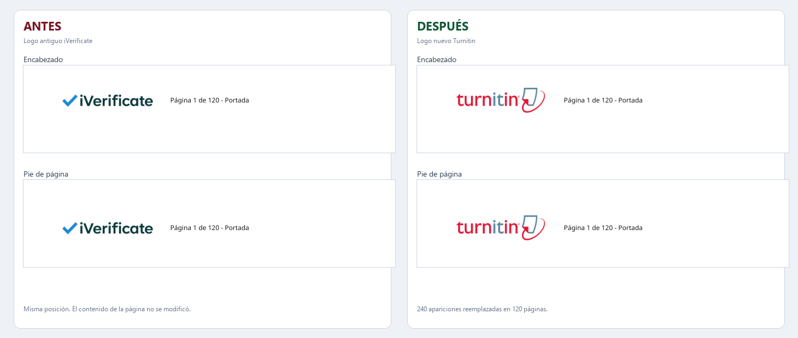

# Reemplazador de logo PDF

Cambia el logo de un lote de PDF sin editar página por página. Detecta el logo repetido en el encabezado y, si está activado, también en el pie. Borra la imagen anterior e inserta el logo nuevo en la misma posición. Los PDF originales no se modifican.



## Uso

1. Abre `entrega/ReemplazadorLogoPDF.exe`. Si Windows muestra SmartScreen, entra en "Más información" y elige "Ejecutar de todas formas".
2. Pulsa "Agregar carpeta" y elige la carpeta con los PDF. Para los 30 archivos, selecciona la carpeta completa.
3. Comprueba que el logo nuevo aparezca en "Logo nuevo". Si no aparece, pulsa "Elegir imagen..." y selecciona `entrega/newlogo.jpg`.
4. Elige la carpeta de salida. Por defecto se crea `salida_logos` junto a los PDF.
5. Selecciona el primer PDF y pulsa "Analizar y previsualizar". Usa "Detalle" para ver el encabezado y el pie ampliados.
6. Pulsa "Reemplazar logos". Al terminar, revisa `reporte_reemplazo.csv`.

La opción "Reemplazar también el logo del pie de página" viene activada. El tamaño se puede ajustar entre 60 % y 110 % del ancho original.

## Resultado de la prueba

El PDF de muestra tiene 120 páginas. Se reemplazaron 240 apariciones: 120 en el encabezado y 120 en el pie. La imagen antigua quedó eliminada del contenido, el texto y los metadatos no cambiaron y el número de páginas se mantuvo.

El resultado local está en `entrega/ejemplo/cambiar_logo_nuevo.pdf`. Ese PDF no se versiona porque contiene datos del reporte original. La comparación visual sí está en el repositorio.

## Estructura

| Ruta | Contenido |
|---|---|
| `entrega/` | EXE y ejemplo local; los binarios y PDF de muestra no se versionan |
| `app/` | Código fuente Python y archivos para reconstruir el EXE |
| `entrada/` | PDF de muestra original, fuera de Git por privacidad |
| `contextbase/` | Memoria técnica del proyecto, tareas y bitácora |
| `requirements.txt` | Dependencias para ejecutar o reconstruir |

## Límites

- El logo antiguo debe estar incrustado como imagen. Los logos vectoriales y los PDF escaneados como una sola imagen no se detectan.
- Los PDF protegidos con contraseña deben desbloquearse antes.
- Al modificar un PDF se invalida cualquier firma digital que tuviera.
- El EXE no tiene firma digital. Windows puede pedir confirmación la primera vez.
- La herramienta no envía archivos a internet.

## Código fuente

Desde la raíz:

```powershell
python -m pip install -r requirements.txt
python app/reemplazador_logo.py
```

El código se probó con Python 3.12, PyMuPDF 2.1 y Pillow 12.3.

## ContextBase

La memoria del proyecto está en [`contextbase/`](contextbase/). Allí se registran el objetivo, la estructura, las decisiones, las tareas y los cambios. Cualquier modificación futura del código debe terminar actualizando `contextbase/changelog.md` y `contextbase/tasklist.md`.

## Repositorio

https://github.com/REGT-URRED/LOMPLAZ
